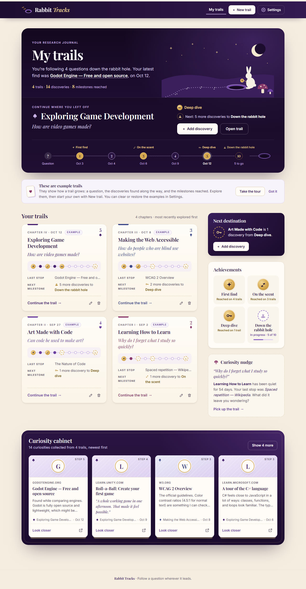
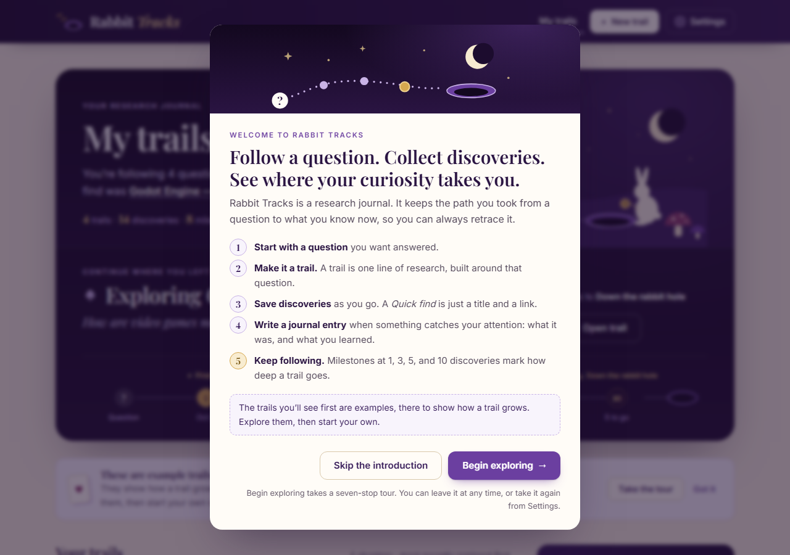
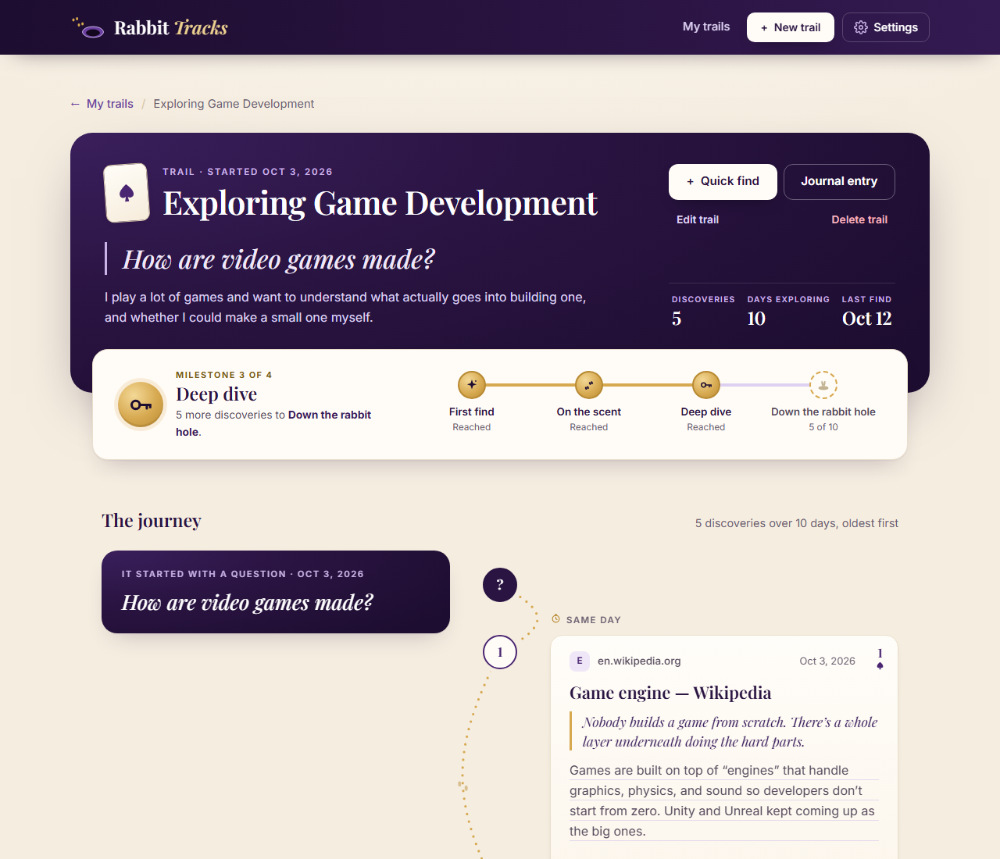

# Rabbit Tracks

Rabbit Tracks is a research journal for following a question wherever it leads. You start a **trail**
with the question you want answered, then save each website you find along the way as a
**discovery**, with a note about what you learned. Each trail shows its discoveries as a timeline in
the order you found them, so you can retrace how you got from the question to what you know now.

It's built for the way curiosity actually works: one link leads to another, and a few days later
it's hard to remember how you got there or why a page mattered.

The repository is `Rabbit-Tracks` and the app is **Rabbit Tracks**. (It was called Rabbit Trails
until October 26, 2026; "trail" is still the name for one line of research inside the app.)







<details>
<summary>More screenshots (every screen and state)</summary>

| Screen | Desktop | Phone |
| --- | --- | --- |
| Dashboard | [dashboard-desktop](docs/screenshots/dashboard-desktop.png), [with one trail](docs/screenshots/dashboard-one-trail-desktop.png) | [dashboard-mobile](docs/screenshots/dashboard-mobile.png) |
| Welcome | [welcome-desktop](docs/screenshots/welcome-desktop.png) | [welcome-mobile](docs/screenshots/welcome-mobile.png) |
| Guided tour | [tour-desktop](docs/screenshots/tour-desktop.png) | [tour-mobile](docs/screenshots/tour-mobile.png) |
| Curiosity cabinet | [cabinet-desktop](docs/screenshots/cabinet-desktop.png), [Look closer](docs/screenshots/curio-desktop.png) | |
| The White Rabbit's question | [rabbit-desktop](docs/screenshots/rabbit-desktop.png) | |
| A trail's journey | [trail-desktop](docs/screenshots/trail-desktop.png) | [trail-mobile](docs/screenshots/trail-mobile.png) |
| Journal entry | [discovery-new-desktop](docs/screenshots/discovery-new-desktop.png) | |
| Settings | [settings-desktop](docs/screenshots/settings-desktop.png) | [settings-mobile](docs/screenshots/settings-mobile.png) |
| Clear all confirmation | [confirm-desktop](docs/screenshots/confirm-desktop.png) | [confirm-mobile](docs/screenshots/confirm-mobile.png) |
| Empty journal | [empty-desktop](docs/screenshots/empty-desktop.png) | |
| Validation, not found, errors | [trail-new-errors](docs/screenshots/trail-new-errors-desktop.png), [not-found](docs/screenshots/not-found-desktop.png), [load-error](docs/screenshots/load-error-desktop.png), [save-error](docs/screenshots/save-error-desktop.png) | |

All were taken from the app in preview mode with its example data. The load-error and save-error
screens can't happen with sample data, so they were produced by making the data call fail the way
the API client does when the server can't be reached.

</details>

## What you can do

- **Trails:** create, open, edit, and delete a trail (title, starting question, optional description)
- **Discoveries, two ways:**
  - **Quick find:** at the end of every trail's path (or from **Quick find** in its header), type a
    title and a link and press **Add to my trail**. Nothing else is needed.
  - **Journal entry:** an open-journal page with *What did you find?* (title), *Where did you find
    it?* (link), *What caught your attention?* (an optional highlight, up to 200 characters), and
    *What did you learn?* (an optional note, up to 500). A switch hides the two reflection fields
    for a quick save; editing a discovery always opens the journal with everything filled in.

  New discoveries go at the end and are dated today. Discoveries can be edited and deleted.
- **The journey:** each trail page is a winding path from the question, through every discovery
  in order, to the rabbit hole. Stops sit on alternating sides (one column on phones), with the time
  between them ("Next day", "3 days later") and a stop of their own wherever a milestone was
  reached. The path draws itself in when a trail opens, carries rabbit tracks, and turns from
  lavender to purple to gold as the trail reaches more milestones.
- **Dashboard:** a night-in-Wonderland welcome with one sentence about where your research stands;
  "Continue where you left off", drawn as a route from the question to the next milestone; your
  trails as chapters (each with its suit, question, tracks, last stop, and next milestone);
  **Next destination** (the trail closest to a milestone); your **Achievements**; a **Curiosity
  nudge** that points back at your least recently explored trail, using only what that trail
  already holds; and the **Curiosity cabinet** across the bottom (see below). Example trails are
  tagged **Example**, with a dismissible note saying what they are.
- **Curiosity cabinet:** every discovery from every trail, newest first, as cards in a display
  case: the site's first letter and the trail's suit, the site, the title, what caught your
  attention (or the start of the note), the trail, and the date. The title opens the trail at that
  discovery; **Look closer** shows everything saved for it (with Visit source, Edit, and Open on
  its trail); the ↗ button opens the source in a new tab. Four at a time, with **Show more**. A
  discovery with no notes offers "Add what you learned"; an empty or small collection ends with an
  open slot that links to adding the next discovery. Nothing is fetched from the saved sites.
- **First visit:** a one-page **welcome** (what a trail, a discovery, Quick find, a journal entry,
  and milestones are), then an optional seven-stop **guided tour** that highlights the real parts
  of the app: My trails, a trail card, the cabinet, Achievements, Quick find and Journal entry (on
  the most recent trail), and Settings. Next, Back, Skip, Esc, and the arrow keys work; on phones
  the tour is a sheet along the bottom. Both can be reopened from **Settings**. Whether you've
  seen them is remembered by your browser (see limitations).
- **The White Rabbit:** select the rabbit in the dashboard's picture and he offers a question worth
  following (from a fixed list of 20). **Follow this question** opens the New trail form with it
  filled in; nothing is saved until you save the form. Ask often enough and he remembers he's late.
- **Settings:** Experience (take the tour again, show the welcome, **Reduce motion**), Your
  research data (where trails are kept, in plain terms, and the connection status with the API),
  Example trails (**Restore examples**, with sample data), Manage your research (**Clear all
  trails**, with sample data; with the API, how to delete instead), and About. Restore and Clear
  all say exactly how many trails and discoveries they remove before asking, warn about unsaved
  writing (an unsaved new trail is kept), and change nothing if they fail.
- **Milestones:** a trail reaches milestones at 1, 3, 5, and 10 discoveries (*First find*,
  *On the scent*, *Deep dive*, *Down the rabbit hole*). Progress shows on every trail card and trail
  page, the journal entry form says when saving will reach one, and reaching one shows a short
  achievement card in the corner (it closes itself, and never blocks the page). Select a milestone
  (on the dashboard or a trail page) to see when and with which discovery it was reached, or how
  close the nearest trail is. Point at a step on a trail card, or a stop on the dashboard's route,
  to see that discovery.
- **Validation:** required fields are checked, and URLs must start with `http://` or `https://`. The
  same rules are checked again by the API.
- **Feedback:** confirmation before anything is deleted, a loading screen, error screens with
  **Try again**, "not found" for missing trails, and a "Couldn't save" message that keeps what you typed
- **Addresses:** every screen has its own address (for example `#/trails/<id>`), so Back, Forward, and
  refresh work
- **Phone and desktop layouts,** a skip link, visible keyboard focus, and focus moving to each
  screen's heading

## Running it

All commands run from the `server/` folder. Install once with `npm install` (needs
[Node.js](https://nodejs.org) 22 or newer).

| | **Preview** (`npm run preview`) | **Full app** (`npm start`) |
| --- | --- | --- |
| Needs MongoDB | No | Yes (`MONGODB_URI` in `server/.env`) |
| Data | Four example trails, kept in the browser tab | Saved in MongoDB through the Express API |
| Changes survive a reload | **No**, the examples come back | **Yes** |
| How you can tell | Settings → "Your research data" says "Kept in this tab only", and offers Restore examples and Clear all trails | Settings → "Your research data" says "Saved on the server" and "Connected" |

### Preview the front end (no MongoDB account needed)

```bash
cd server
npm install
npm run preview
```

Open **http://localhost:3000**. This is the real front end (timeline, milestones, forms, dialogs) with
its built-in sample data. Every action works, but nothing is saved: reloading the page brings back
the four example trails. Preview mode has no API and never calls one. **Settings** can restore the
examples or clear every trail to show the empty state.

You can also open `index.html` directly from disk (double-click it) for the same sample-data mode,
without Node.js.

### Run the full app with MongoDB

1. Get a MongoDB database: a free [MongoDB Atlas](https://www.mongodb.com/atlas) cluster, or
   [MongoDB Community Server](https://www.mongodb.com/try/download/community) installed locally.
2. Configure and start:

   ```bash
   cd server
   cp .env.example .env        # then set MONGODB_URI in .env (see below)
   npm run seed                # optional: adds the four example trails if the database is empty
   npm start
   ```

3. Open **http://localhost:3000**.

For Atlas: create a cluster and a database user, allow your IP address under Network Access, then
copy the "Connect → Drivers" connection string into `MONGODB_URI`, with the user's password in place
of `<password>`.

`npm start` never falls back to sample data. If `MONGODB_URI` is missing or the database can't be
reached, it stops with a message saying what failed (the host it tried, never the password) and
reminds you that `npm run preview` works without a database. `server/.env.example` points at a local
MongoDB (`mongodb://127.0.0.1:27017`), so a copied `.env` fails until that is running or you replace
the URI.

### Check that the API and database are connected

With `npm start` running, any of these:

- The terminal prints `Connected to <host>, database "rabbit_trails"` and `Running at http://localhost:3000`.
- Open **http://localhost:3000/api/health**. It should show `{"status":"ok","database":"connected"}`.
- In the app, open **Settings**. It should say "Connected. The API and database are responding."
- Add a discovery and reload the page. It should still be there.

> Opening `index.html` through a different web server (such as VS Code Live Server) uses API mode,
> but there's no API at that address, so the app shows "The Rabbit Tracks API isn't available at
> this address". Use `npm run preview` or `npm start` instead.

Fonts load from Google Fonts. Without an internet connection, the page uses fallback fonts.

## Environment variables

Only needed for `npm start` and `npm run seed`. Set them in `server/.env` (Git ignores it); `server/.env.example` has the template. `npm run preview` only reads `PORT`, and only from the environment.

| Variable | Required | Default | Purpose |
| --- | --- | --- | --- |
| `MONGODB_URI` | Yes | none | MongoDB connection string, for example `mongodb://127.0.0.1:27017` or an Atlas `mongodb+srv://…` string |
| `MONGODB_DB` | No | `rabbit_trails` | Database name. It's created on the first write. It keeps the app's earlier name so existing databases still load. |
| `PORT` | No | `3000` | Port for the app (both modes) |

## API

Express serves the front end and a JSON API from the same address, so no CORS setup is needed. The
data is stored in one MongoDB collection, `trails`. Each trail document holds its discoveries in an
array, in the order they were found.

| Method | Path | Purpose | Success |
| --- | --- | --- | --- |
| GET | `/api/health` | Check that the API and database are responding | 200 |
| GET | `/api/trails` | List trails, most recently updated first | 200 |
| GET | `/api/trails/:id` | One trail with its discoveries | 200 |
| POST | `/api/trails` | Create a trail | 201 |
| PUT | `/api/trails/:id` | Edit a trail | 200 |
| DELETE | `/api/trails/:id` | Delete a trail | 204 |
| POST | `/api/trails/:id/discoveries` | Add a discovery to the end of a trail | 201 |
| PUT | `/api/trails/:id/discoveries/:discoveryId` | Edit a discovery | 200 |
| DELETE | `/api/trails/:id/discoveries/:discoveryId` | Delete a discovery | 204 |

**Request bodies** are JSON. Trail: `title` (required, up to 80 characters), `question` (required, up
to 140), `description` (up to 300). Discovery: `title` (required, up to 120), `url` (required,
`http`/`https`, up to 2000), `highlight` (up to 200; "What caught your attention?", added October
26, 2026), `note` (up to 500). Unknown fields are ignored. Discoveries saved before `highlight`
existed simply have none; the app treats a missing one as empty.

**Responses** use plain `id` strings:

```json
{
  "id": "6720f1c2a4b5c6d7e8f90123",
  "title": "Exploring Game Development",
  "question": "How are video games made?",
  "description": "",
  "created": "2026-10-03",
  "updated": "2026-10-12T16:20:05",
  "discoveries": [
    { "id": "6720f1c2a4b5c6d7e8f90124", "date": "2026-10-03", "title": "Game engine — Wikipedia", "url": "https://en.wikipedia.org/wiki/Game_engine", "note": "…" }
  ]
}
```

**Errors** are `{ "error": "message" }` with status `400` (invalid input or malformed JSON), `404`
(unknown or malformed id, or unknown API route), or `500` (server or database problem; details are
logged on the server, not sent to the browser).

**In the browser**, `js/api.js` makes these requests. Each failed request logs one line to the
console with the operation, status, and message, for example
`[Rabbit Tracks] API request failed: GET /api/trails → no response: Couldn't reach the Rabbit Tracks server…`.
Request bodies aren't logged. Requests time out after 10 seconds.

## Testing

```bash
cd server
npm test
```

32 automated tests:

- **17 API tests** send real HTTP requests to the API, backed by a real MongoDB server that
  [`mongodb-memory-server`](https://github.com/typegoose/mongodb-memory-server) starts and throws away
  (your own database is never touched). They cover every endpoint, validation, 404s, malformed JSON,
  discovery order, the optional highlight, the seed data, and which files the server makes public.
- **4 milestone tests** load `js/milestones.js` as-is and check the thresholds, progress, when a
  milestone is reached, and the totals across trails.
- **11 preview and start-up tests:** the front end is served with sample data (never `auto`, never
  cached), no API, no database, no preview label, and a single "New trail" link in the header;
  the journal's field limits match the API's; every guided-tour stop points at an element that
  exists; every button and switch in Settings has a handler; the data-mode tag the server fills in
  is the one `app.js` reads; `npm run preview` needs no MongoDB settings; `npm start` exits without
  `MONGODB_URI`.

The first run downloads the MongoDB binary (several hundred MB), so it needs an internet connection
and can take a few minutes.

The rest of the front end has no automated test suite in this repository. See
[PROGRESS.md](PROGRESS.md) for the browser checks run on October 26, 2026.

## Project structure

```
Rabbit-Tracks/
├── index.html              every screen; app.js shows one at a time
├── css/styles.css          all styles (design tokens at the top)
├── js/
│   ├── app.js              navigation, screens, forms, dialogs, Settings, milestone display,
│   │                       the curiosity cabinet, the welcome, the guided tour, the White Rabbit
│   ├── api.js              API client (used when served by the server)
│   ├── sample-data.js      the example trails + an in-memory version of the API (used from disk)
│   └── milestones.js       milestone definitions and progress math (no HTML)
├── images/favicon.svg
├── server/
│   ├── server.js           npm start: reads .env, connects to MongoDB, serves the API + front end
│   ├── preview.js          npm run preview: serves the front end with sample data, no database
│   ├── src/app.js          Express routes, error handling, front-end serving for both modes
│   ├── src/trails.js       MongoDB reads and writes
│   ├── src/validation.js   field rules (same as sample-data.js)
│   ├── src/db.js           connection, with password-free error messages
│   ├── scripts/seed.js     adds the example trails (npm run seed)
│   ├── test/               API, milestone, preview-mode, and start-up tests
│   └── .env.example
├── docs/screenshots/
├── archive/                earlier versions, kept for reference only (see archive/README.md)
├── DESIGN.md               design decisions
└── PROGRESS.md             checklist, testing notes, open questions
```

`app.js` never touches data directly. It calls functions like `trailData.createTrail()`, and
`trailData` is either `apiData` (`api.js`) or `sampleData` (`sample-data.js`). The server picks
which by filling in `<meta name="rabbit-tracks-data">` in `index.html` (`api` for `npm start`,
`sample` for `npm run preview`); opened from disk, the page uses sample data. Both have the same
functions and fail the same way (an error with an HTTP-style `status`).

Milestones are calculated from each trail's number of discoveries, so nothing extra is stored.
`milestones.js` has the rules and the math (no HTML), `app.js` draws them, and reaching one fires a
`rabbittracks:milestone` event on `document` with the milestone, the new discovery count, and the
trail. The achievement card is one listener; later features can add their own without changing the
save code.

## Built with

- **Front end:** HTML, CSS, and JavaScript, with no framework or build step. Playfair Display and
  Inter from Google Fonts.
- **Back end:** Node.js (22+), [Express 5](https://expressjs.com), and the official
  [MongoDB Node.js driver](https://www.mongodb.com/docs/drivers/node/current/).
- **Tests:** Node's built-in test runner and `mongodb-memory-server`.

## Current limitations

- **No accounts.** Everyone using the same server shares the same trails.
- **No deployment.** The app runs locally; it isn't hosted anywhere yet.
- **Preview mode doesn't save.** With `npm run preview` or `index.html` opened from disk, changes are lost on reload.
- **Dates use the server's time zone.** "Today" for a new discovery is the server's date.
- **Discoveries can't be reordered**, and their dates can't be edited.
- **Milestones count discoveries only.** Each trail earns its own; the dashboard adds them up.
  There are no points, streaks, or leaderboards.
- **Preferences belong to the browser, not to you.** Whether you've seen the welcome or the tour,
  the Reduce motion choice, and the dismissed examples note are kept in this browser's
  `localStorage` (keys starting `rabbit-tracks.`). They aren't synced to other browsers or devices,
  and they're shared by anyone using the same browser. They're kept in both modes, so the welcome
  doesn't return on every reload with sample data (which does reset). If storage is blocked, the
  app works the same and simply asks again. Clearing site data brings the welcome back.
- **"Example" is recognised by title and question.** A trail matching one of the four examples is
  tagged Example; once you edit its title or question it's treated as your own.
- **No clear-all or restore with the API.** The API has no bulk endpoints, so Settings explains how
  to delete trails one at a time instead (and `npm run seed -- --reset` remains the server-side reset).
- **Only tested in headless browsers** (Microsoft Edge and Chrome, automated) so far. Firefox,
  Safari, real phones, and screen readers haven't been tested.
